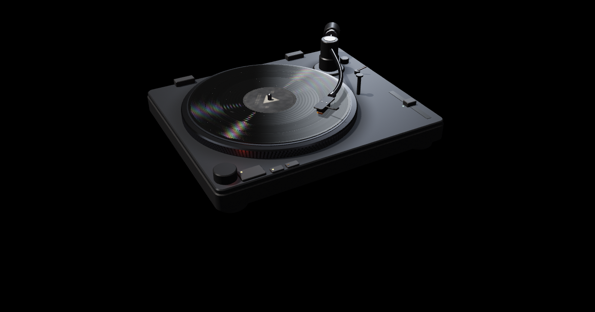

# I Love My Computer, on a simulated record player

A fan remix of Guillermo Rauch's [vinyl](https://github.com/rauchg/vinyl), rebuilt as a love letter to Ninajirachi's album [_I Love My Computer_](https://ninajirachi.bandcamp.com/album/i-love-my-computer): **[ilmc.daracloud.uk](https://ilmc.daracloud.uk)**.

The deck is Guillermo's physical simulation: music is cut into a spiral groove and a simulated stylus, cantilever, tonearm and cartridge read it back. Around it this remix adds a bedroom full of old computers that performs the song. Bring your copy of _Fuck My Computer_ and the room knows it, start to finish:

- **The room** wakes up screen by screen, in hard-flash photographs, while the lead computer (the beige one with the chrome :3 face) sings her words.
- **The drops** throw everything into the air and fly it through Y2K wallpaper skies, then over a city of lit windows.
- **The crash**: a blue screen, and the drop hung inside a System message window.
- **The hill**: the whole pile set down on the wallpaper hill, from noon through sunset to a moonlit night, where the machines fire CDs on her vocal chops into the second drop.
- **The white**: the lyric set enormous behind the machines.
- **Shutdown**: the room powers down and the lead falls asleep.

The camera is directed, cut on the bar lines; drag or scroll and it is yours. Any other song still plays, and the room follows its kicks.



## Bring your own copy

No music, album art or audio from the album is in this repository or on the site.

- You insert your own file (MP3, FLAC, WAV, M4A/AAC, Ogg, Opus; whatever your browser can decode). It is decoded, cut and pressed in your browser. Nothing is uploaded.
- The title, artist and album art come from the file's own tags ([`src/ilmc/meta.js`](src/ilmc/meta.js) reads ID3, FLAC, MP4 and Vorbis tags).
- To recognise the song, the page compares your file's loudness over time with the song map ([`src/ilmc/match.js`](src/ilmc/match.js)). That works across encodings and a few seconds of extra silence, and tells it which way to shift the map.
- The song map ([`assets/ilmc/fmc.json`](assets/ilmc/fmc.json)) holds what the room needs to play along: tempo, downbeats, the acts, the build-ups, her vocal chops and lyrics timed to the syllable. The timings were measured from the track; the lyric lines come from [LRCLIB](https://lrclib.net).

If you don't have it, it's on [Bandcamp](https://ninajirachi.bandcamp.com/album/i-love-my-computer).

## The room

Everything around the deck is in [`src/ilmc/`](src/ilmc/), built with [three.js](https://threejs.org) (vendored in `src/vendor/`) in the deck's own WebGL context, so the computers share its depth buffer and their screens light the record:

- `index.js` is the conductor: the song map, the acts, the 4-5-6-2 jig, lyrics, build-ups, lights. `director.js` runs the camera from a shot list written against bar numbers, and checks each shot can see what it points at.
- `post.js` is the camera: deck and room are drawn in linear light into one HDR picture, then contact shading, depth of field, glow, flare, a grade per act, and the music-video treatment (flash frames, glitch, PS1 dither).
- `sky.js`, `hill.js`, `fx.js`: the wallpaper skies, the hill with its grass and sunset, and everything in the air. `plates.js` sets the lyric as giant type; `desk.js` is the blue screen, the desktop and the shutdown card.
- `models.js`, `hq.js`, `wear.js` model the machines and age their plastic; `cables.js` grows the wiring; `discs.js` throws the CDs.
- `shell.js`, `shell-art.js` build the bedroom and its posters; `set.js` dresses the floor from the kit in `props.js` (scanned CC0 models in `assets/ilmc/props/`, clothes and magazines made in code).
- `screens.js` and `viz/` draw every screen: visualisers, period software, and the :3 face (`viz/face.js`), which lip-syncs to syllable times in the song map.
- `overlay.js` puts the words on top; `sfx.js` synthesises the interface sounds. No samples.

A machine that cannot keep up gets a cheaper picture in steps (`?q=0`, `1` or `2` pins one).

The flashing can be turned down from the top bar, and starts reduced if your system asks for reduced motion.

## Running it

Node 22+ and nothing to install:

```bash
$ npm run build          # writes dist/
$ npx serve dist         # any static server works; it must be https or localhost (AudioWorklet needs a secure context)
$ npm test               # Guillermo's offline physics checks
```

It deploys to Cloudflare as a static Worker (`wrangler.toml`):

```bash
$ npm run deploy         # build, then wrangler deploy
```

Cloudflare limits a file to 25 MiB, so the public shelf leaves out the five records whose cut is bigger (they're still in `records/` and play locally).

## Credits

- Deck, groove, physics, shelf: [Guillermo Rauch](https://github.com/rauchg/vinyl) (MIT).
- The room: Dara Adedeji.
- Floor props and surfaces: CC0 models from [Poly Haven](https://polyhaven.com) and textures from [ambientCG](https://ambientcg.com); each is listed with its author in [`assets/ilmc/props/manifest.json`](assets/ilmc/props/manifest.json).
- Music, lyrics, the :3 face and everything _I Love My Computer_: Ninajirachi. This is an unofficial fan project, not affiliated with her or her label.

---

# vinyl

Guillermo's original README follows.

A record player simulated "from the groove up" in the browser: **[vinyl-gl.vercel.app](https://vinyl-gl.vercel.app)**.

Instead of playing an audio file, the music is cut into a spiral groove, and a simulated stylus, cantilever, tonearm and cartridge read it back on the audio thread. What you hear is the voltage that motion would induce in the cartridge, after phono equalisation.

## How it works

**1️⃣ Cut.** The lathe ([`src/cut.js`](src/cut.js)) turns audio into the shape of the two walls of a [45/45 stereo groove](https://en.wikipedia.org/wiki/Phonograph_record#Stereophonic_sound) at 33⅓ rpm: RIAA pre-emphasis, an acceleration limiter so the cutter could have cut it, and a spiral pitched so the side fits on a 12" disc.

**2️⃣ Press.** The pressing plant ([`src/press.js`](src/press.js)) changes the geometry itself: wall roughness, dust, scratches, warp, an off-centre hole, groove echo. Nothing in it is an audio effect. It's seeded, so the same record always presses the same way.

**3️⃣ Play.** The engine ([`src/engine.js`](src/engine.js), [`src/engine-core.js`](src/engine-core.js), [`src/groove.js`](src/groove.js)) rides the stylus over those walls. A tip of finite radius can't follow the wall exactly, and that's where tracing distortion, pinch effect and inner-groove loss come from. Too little tracking force and it leaves the wall.

**4️⃣ Draw.** The deck ([`src/render.js`](src/render.js), [`src/shaders.js`](src/shaders.js)) draws the disc from the cut itself: the actual spiral, lit by how hard each revolution is modulated.

## Records

Cutting a whole side takes a while, so the records on the shelf are cut ahead of time and committed to `assets/`. The clean cut ships as 16-bit [DPCM](https://en.wikipedia.org/wiki/Differential_pulse-code_modulation) inside FLAC (within a quarter of a nanometre of the cut wall), and the page presses it with the seed. The source audio lives in `records/`, listed in [`src/records.js`](src/records.js).

To add a record, or after changing the lathe, re-cut what's out of date (needs `ffmpeg`) and commit `assets/`:

```bash
$ npm run lathe           # every record that is out of date
$ node lathe.mjs toccata  # just this one
```

The build refuses to deploy a shelf record that was never cut.

## Credits

Every recording is public domain or freely licensed:

- Gershwin, _Rhapsody in Blue_: George Gershwin, piano, with Paul Whiteman's Concert Orchestra, Victor, 1924 ([LOC](https://www.loc.gov/item/jukebox-70342/))
- Beethoven, _Moonlight Sonata_: Paul Pitman, piano, for Musopen
- Satie, _Gymnopédie No. 1_: Robin Alciatore, piano, for Musopen
- Chopin, _Nocturne Op. 9 No. 2_: Frank Lévy, piano, for Musopen
- Debussy, _Clair de lune_: Laurens Goedhart, piano, 2011
- Grieg, _In the Hall of the Mountain King_: Musopen Symphony
- Tchaikovsky, _1812 Overture_: US Marine Band, live at Wolf Trap, 2019
- Bach, _Toccata and Fugue_: Ashtar Moïra, organ
- Vivaldi, _Summer: Presto_: John Harrison, violin, with the Wichita State University Chamber Players (CC BY-SA 4.0)
- HoliznaCC0, _Summer Air_ (CC0, [Free Music Archive](https://freemusicarchive.org/music/holiznacc0/summer-air-lo-fi/))

Sources for each are linked in [`src/records.js`](src/records.js). The _Demo EP_ is synthesised by the page.

## License

The remix is MIT, like the deck it is built on (see `LICENSE`).

The code is [MIT](LICENSE). The recordings in `records/`, and the records cut from them in `assets/`, keep their own licenses, listed above. _Summer: Presto_ is CC BY-SA 4.0, so its cut is too.
